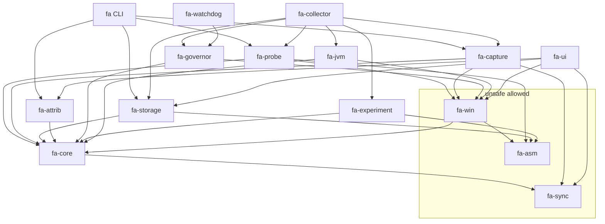
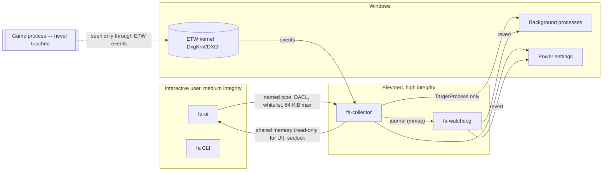
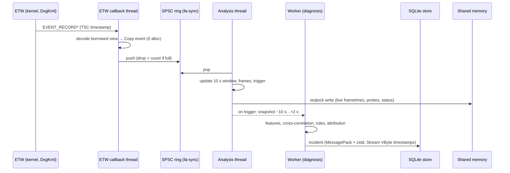

# FrameAutopsy — Architecture

> Target architecture agreed during the 2026-11-20 brainstorming. Each crate is created by the lot that first needs
> it (`roadmap.md`). Requirements live in `specifications.md`; the asm/unsafe ledger in `docs/asm-unsafe-catalog.md`.

## 1. Principles

1. **Closed loop**: observe → diagnose → act → prove (handoff §2).
2. **Never touch the game**: no handle, no memory access, no injection, no hook. Games are detected by image name or
   window class (Minecraft). All actions target other processes or system settings through `TargetProcess`.
3. **Unsafe and asm earn their place** and live in three crates, split by how they are verified.
4. **One timebase**: TSC ticks everywhere (ETW in `ClientContext = 3` when the TSC is invariant).
5. **Least privilege**: only the collector (and its watchdog) runs elevated in normal use; the UI never does; the CLI
   only for `install`/`uninstall` and developer commands (`capture`, `lab run`, `lab campaign`).
6. **Bounded everything**: memory windows, ring sizes, disk retention, probe duty cycle, collector budget.

## 2. Crates

| Crate | `unsafe` | Responsibility | Born in lot |
|---|---|---|---|
| `fa-asm` | yes | asm and SIMD kernels: TSC reads, probes, cycle burn, cache flush, Stream VByte, cross-correlation, selection, PRNG | 0 |
| `fa-win` | yes | Windows FFI: ETW, process and power APIs, topology, clock (QPC, TSC calibration), own-thread pinning, shared memory, named pipes and DACLs, D3D11, Direct2D/DirectComposition | 0 |
| `fa-sync` | yes | SPSC ring, cross-process seqlock (atomics only), shared-region reader (only if it earns its place), counting test allocator (`test-support` feature) | 0 |
| `fa-core` | no | window ring, stutter trigger, TOML rule engine, allocation-free FSM, compliance matrix and `TargetProcess`, pure clock math (tick conversion, QPC-TSC map) | 0 |
| `fa-probe` | no | probe orchestration (uses `fa-win` pinning), preemption rejection, health check verdicts | 3 |
| `fa-capture` | no | decoding of borrowed ETW records into typed `Copy` events, frame extraction (PresentMon algorithm) | 5 |
| `fa-storage` | no | SQLite WAL, MessagePack, zstd, retention | 8 |
| `fa-attrib` | no | `.pdata` (`goblin`) and PDB (`pdb`) resolution, symbol cache, **only crate that reaches the internet** (opt-in); used by the non-elevated `fa-ui` and `fa` only | 11 |
| `fa-governor` | no | actions, journal, autonomy modes | 12 |
| `fa-experiment` | no | A/B protocol, permutation test, bootstrap | 13 |
| `fa-jvm` | no | hsperfdata, JFR, GC correlation | 15 |

Binaries:

| Binary | Elevated | Role | Born in lot |
|---|---|---|---|
| `fa` | no; `install`/`uninstall` raise one UAC prompt; developer commands `capture`, `lab run`, `lab campaign` need an elevated terminal | CLI: `check`, `clock`, `lab run`, `lab campaign`, `lab score`, `export`, `install`, `uninstall` | 2–4 |
| `fa-collector` | yes (scheduled task, binary in Program Files) | headless: ETW session, module map, window, trigger, diagnosis, governor, experiments, writes the store | 7 |
| `fa-watchdog` | yes (started by the collector) | waits on the collector's mutex; reverts the governor journal when it is abandoned | 12 |
| `fa-ui` | no | egui dashboard, live view, symbol resolution, overlay window; may run during play, never required | 9 |

## 3. Processes and trust boundaries

| Boundary | Threat | Control |
|---|---|---|
| UI → collector (pipe) | A non-elevated process makes the elevated collector act on arbitrary processes or paths | DACL (interactive user + Administrators); length cap; strict schema; commands carry collector-issued ids only; every rejection logged |
| Collector → UI (shared memory) | UI or another process tampers with live data read by the collector | UI maps read-only; the collector never reads back the shared region |
| Collector → processes | Action on the game, an anti-cheat or a critical process | `TargetProcess` (type-level), matrix verdicts, minimal access rights, identity check before undo |
| Collector crash | Machine left modified | write-ahead journal + watchdog (abandoned-mutex detection, no process handle) + revert at startup |
| Elevated binaries | A medium-integrity process replaces `fa-collector.exe` and gets silent elevation at logon | binaries installed in `%ProgramFiles%\FrameAutopsy`; the scheduled task never points at `target\` or any user-writable path |
| Collector state | Tampering with the journal, store, autonomy modes or experiment results | `%ProgramData%\FrameAutopsy` with write access for SYSTEM and Administrators only |
| User-writable inputs read by the collector | Overrides or health baselines in `%LOCALAPPDATA%` used to steer the collector | validated like pipe messages (size cap, strict schema); overrides can only disable |
| Symbols download | Network exposure; malicious PDB parsed with admin rights | opt-in; Microsoft and NVIDIA public servers only; download and parsing happen only in non-elevated `fa-ui`/`fa`; `fa-attrib` is the only crate reaching the internet |
| LoL Live Client Data API | Network use beyond the machine | loopback-only client, host asserted by a test |
| Lab injectors | Harm to a real game or the disk | refuse while a matrix game runs, duration and disk caps, cleanup on Ctrl+C |

## 4. Data flow (collector, steady state)

Hot path = callback → ring → window → trigger: allocation-free, tested with the counting allocator. Diagnosis,
attribution and storage run on the worker and may allocate.

## 5. Timebase

- `fa-asm::tsc::now()` / `now_serialized()`; TSC frequency from CPUID `0x15` or calibration against QPC.
- ETW session with `ClientContext = 3`, consumed with `PROCESS_TRACE_MODE_RAW_TIMESTAMP` → event timestamps stay raw
  TSC values (without that flag `ProcessTrace` converts them), directly comparable with probe samples.
- Without an invariant TSC: QPC everywhere, converted through the same API; the health check reports the degraded mode.
- External clocks mapped into TSC: QPC (calibrated mapping, re-estimated every 60 s), JFR ticks (lot 15, to verify),
  wall clock (session start record).

## 6. Budgets (calibrate)

| Item | Budget |
|---|---|
| Collector CPU, 30-min game session | < 1 % of one logical CPU on average |
| Collector private working set | < 50 MB |
| In-game probe duty cycle | ≤ 0.01 % per CPU, only on CPUs without game hot threads |
| UI first frame / working set | < 300 ms / < 60 MB |
| Overlay update | ≤ 0.2 ms CPU at 10 Hz |
| Store | 30 rolling days and 2 GB |
| Symbol cache | 2 GB |
| `fa check` | ≤ 90 s |

## 7. Storage layout

| Location | Writer | Content |
|---|---|---|
| `%ProgramFiles%\FrameAutopsy\` | `fa install` (admin) | binaries |
| `%ProgramData%\FrameAutopsy\` (admin-only write, users read) | collector, watchdog | `store.db` (SQLite WAL), `governor.journal`, `logs\` |
| `%LOCALAPPDATA%\FrameAutopsy\` | user processes | `health\*.json`, `symbols\`, UI preferences, overrides, `lab\` (ground-truth logs, temporary files) |
| repo `lab/fixtures/` | `fa lab campaign` | versioned Lab fixtures (≤ 50 MB) |

Nothing is written inside game, launcher or mod folders.

## 8. Open points for the builder

- Exact ETW keywords and provider flags (follow PresentMon's source).
- ~~Whether Windows 11 system providers allow kernel events in a private session instead of the NT Kernel Logger~~:
  verified 2026-11-22 on build 26300, a private session started with `EVENT_TRACE_SYSTEM_LOGGER_MODE` and
  `EnableFlags` receives DPC/ISR, image-load and stack-walk events (`docs/decisions.md` section 2).
- egui plotting details and decimation strategy.
- JFR tick source on Windows (lot 15).
- How the non-elevated UI opens the WAL store in `%ProgramData%` read-only (SQLite needs the `-shm` file readable;
  verify the read-only WAL mode, or have the collector publish read snapshots).

## 9. Target machine (2026-11-20)

Intel Core i5-11400H (Tiger Lake-H, 6 cores / 12 threads, one LLC, no hybrid cores), AVX2 and AVX-512 available,
WAITPKG absent (to confirm by CPUID), MWAITX absent (AMD only); 2 × 16 GB DDR4-3200; NVIDIA RTX 3060 Laptop + Intel UHD
(Optimus); Windows 11 26H2 (build 26300). Every asm module must win **on this machine**; paths it cannot exercise
(hybrid, dual-CCD, WAITPKG, MWAITX) are either tested with synthetic fixtures or not built.
