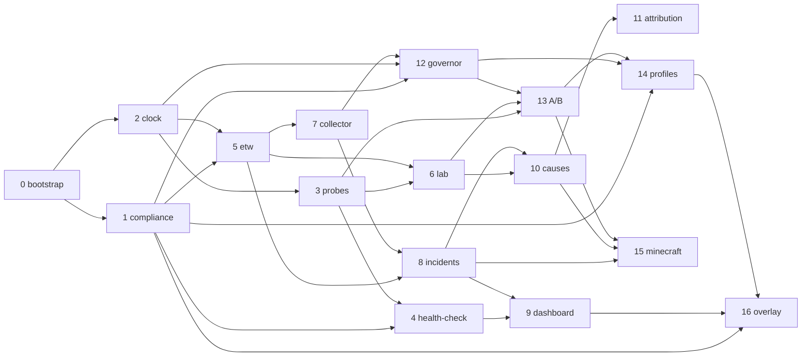

# FrameAutopsy : feuille de route par lots

Sources : `handoff-origin.md` (vision), session de brainstorming du 2026-11-20 (décisions dans `docs/decisions.md`).
Spécifications : `specifications.md` (une section par capacité, au format OpenSpec). Annexes : `docs/architecture.md`,
`docs/asm-unsafe-catalog.md`, `docs/compliance.md`.

Ce fichier donne l'ordre, le périmètre, le critère de fin et le prompt de lancement de chaque lot. **Un lot = une
change OpenSpec** (`openspec/changes/<change-id>/`), archivée quand le lot est terminé.

## Ligne directrice

- **Tout asm et tout `unsafe` se mérite.** Chaque module a une version de référence (Rust sûr, intrinsics, crate
  existante ou compteur Windows). Il doit la battre sur une mesure déclarée, sinon on garde la référence. Il a aussi une
  version de secours choisie au lancement selon le CPU et des tests de parité. Le registre est
  `docs/asm-unsafe-catalog.md`.
- **On ne touche jamais au jeu.** Aucun handle, aucune lecture mémoire, aucune injection. Les actions portent sur les
  autres processus et sur le système, à travers le type `TargetProcess` et la matrice `compliance.toml`.
- **Premier résultat visible : le bilan de santé** (lots 0 à 4), sans droits admin, sans ETW et sans jeu lancé.

## Règles communes à tous les lots

- Un lot = un commit, ou une petite série de commits, sur une branche dédiée (Conventional Commits en anglais). La gate
  doit être verte avant de passer au lot suivant.
- **Gate** (`scripts/gate.ps1`, écrit au lot 0) :
  ```powershell
  cargo fmt --all -- --check
  cargo clippy --workspace --all-targets -- -D warnings
  cargo test --workspace                       # inclut le test d'allocateur
  cargo +nightly miri test -p fa-sync          # dès le lot 5
  cargo run -p fa --release -- lab score       # dès le lot 10 : fixtures enregistrées, sans admin ni GPU
  graphify update .
  ```
  Un lot qui touche un kernel `fa-asm` ou une structure `fa-sync` lance aussi son bench
  (`cargo bench -p fa-asm --bench <module>_vs_<reference>`) et colle le résultat dans `docs/asm-unsafe-catalog.md`.
- **Checkpoint d'explication** : chaque nouveau bloc `unsafe` ou asm est expliqué en français (ce qu'il fait, pourquoi
  il est correct, ce qui le casserait). Il n'est fusionné qu'après ton « compris ».
- Skills à charger : `rust-cargo` et `ponytail` toujours. Ajouter `frameautopsy-invariants` (créé au lot 0) et
  `frameautopsy-tos-guard` (créé au lot 1) dès qu'ils existent. Ajouter `threat-modeling` pour les lots 7 et 12, et
  `mutation-verified-testing` pour les tests de garde (matrice, `TargetProcess`, seuils).
- Les valeurs marquées « (calibrate) » dans les spécifications sont des points de départ : le lot qui les recalibre
  note la nouvelle valeur et sa mesure.
- Cocher les cases du `tasks.md` de la change au fil de l'eau ; archiver la change à la fin du lot.

## Vue d'ensemble

| Lot | Change id | Capacités | Dépend de | Taille | Résultat visible |
|---|---|---|---|---|---|
| 0 | `bootstrap-workspace` | `workspace-hygiene`, `unsafe-policy` | – | M | gate verte sur un workspace vide |
| 1 | `compliance-matrix` | `compliance-matrix` | 0 | M | `compliance.toml` + `docs/compliance.md` sourcé |
| 2 | `clock-and-topology` | `tsc-clock`, `cpu-topology` | 0 | S | `fa clock` : horloge TSC calibrée, topologie |
| 3 | `driverless-probes` | `driverless-probes` | 2 | L | sondes en ligne de commande |
| 4 | `health-check` | `health-check` | 1, 3 | M | **`fa check` : verdict sur ton portable** |
| 5 | `etw-capture` | `etw-capture`, `lockfree-transport` | 1, 2 | L | frametimes captés, parité PresentMon |
| 6 | `stutter-lab` | `stutter-lab` | 3, 5 | L | saccades provoquées et journalisées |
| 7 | `collector-service` | `collector-ipc` | 5 | M | collecteur élevé + premier test anti-triche |
| 8 | `incident-store` | `incident-store` | 5, 7 | M | incidents figés et stockés |
| 9 | `dashboard` | `dashboard` | 4, 8 | M | interface egui : sessions, timeline |
| 10 | `cause-engine` | `cause-engine` | 6, 8 | L | causes classées, score sur le Lab |
| 11 | `driver-attribution` | `driver-attribution` | 10 | M | « tel pilote cause tes DPC longs » |
| 12 | `governor` | `governor` | 1, 2, 7 | L | actions annulables, journal, watchdog |
| 13 | `ab-experiment` | `ab-experiment` | 3, 6, 12 | L | « cette règle améliore ton 1 % low de X % » |
| 14 | `game-profiles` | `game-profiles` | 1, 12, 13 | M | profils des 5 jeux, tests anti-triche |
| 15 | `minecraft-jvm` | `minecraft-jvm` | 8, 10, 13 | M | pauses GC reliées aux saccades |
| 16 | `overlay` | `overlay` | 1, 9, 14 | M | overlay système, jeu par jeu |

Phases : **fondations** (0–1), **bilan de santé** (2–4), **capture** (5–9), **diagnostic** (10–11),
**agir et prouver** (12–13), **jeux** (14–15), **overlay** (16).



---

## Lot 0 : `bootstrap-workspace`

**Objectif** : un dépôt propre, petit sur disque, avec la gate et la politique `unsafe` en place avant toute ligne de
code métier. Il comprend aussi l'initialisation d'OpenSpec et de Graphify (handoff 5.2 à 5.4).

**Contenu**
- Workspace, `crates/fa-core`, `fa-asm`, `fa-win`, `fa-sync` (squelettes avec en-têtes de lints), réglages de profil du
  handoff, `.gitignore` (dont `profile.md`), `.graphifyignore`, `scripts/gate.ps1`, allocateur compteur de test,
  harnais criterion.
- `CLAUDE.md` (conventions de la section 8 du handoff, ligne directrice ci-dessus), `README.md` court.
- OpenSpec : init (vérifier la commande exacte avec `--help` ou la doc officielle), `openspec/config.yaml` (brouillon
  en annexe A), puis création des changes des lots 0 à 4 à partir de `specifications.md`. Une change n'est créée qu'au
  moment où son lot approche, pour éviter les specs périmées.
- Skill projet `frameautopsy-invariants` (modèle : `riftmind-invariants`) : confinement de l'`unsafe`, règle « se
  mérite », zéro allocation, gate.

**Invariants** : `unsafe-policy` en entier, testé par un essai qui doit échouer (`unsafe` dans `fa-core`).

**Fin du lot** : gate verte ; `git status` ne montre ni `target/` ni `profile.md` ; `openspec list` montre les changes
0 à 4.

**Ce que tu apprends** : lints `forbid`/`deny`, profils Cargo, allocateur global de test.

**Prompt**
```
On attaque le lot 0 de roadmap.md (change bootstrap-workspace). Charge rust-cargo et ponytail.
Vérifie la commande d'init d'OpenSpec avant de la lancer, puis crée les changes 0 à 4 depuis specifications.md.
Montre-moi la gate qui échoue sur un unsafe volontaire dans fa-core avant de la déclarer verte.
```

---

## Lot 1 : `compliance-matrix`

**Objectif** : la conformité inscrite dans le produit avant toute capture. Il complète les recherches de
`docs/compliance.md` (brouillon déjà sourcé) et code la matrice.

**Contenu** : `compliance.toml` (7 colonnes : `lol`, `valorant`, `fortnite`, `overwatch2`, `minecraft-java`, `fa-lab`,
`unknown`), chargeur dans `fa-core`, override qui peut seulement désactiver, type `TargetProcess`, test source sur
`OpenProcess`, tests de matrice. Lecture complète des textes officiels encore non lus : EULA Fortnite, EULA Blizzard,
EULA Minecraft en entier, politique développeurs Riot.

**Invariants** : `compliance-matrix` en entier. Le skill projet `frameautopsy-tos-guard` (modèle : `riftmind-tos-guard`)
est créé ici : il rend un verdict PASS ou BLOCK pour tout lot qui touche une source de données, une action, l'UI ou
l'overlay.

**Fin du lot** : `TargetProcess::try_new` refuse les 5 jeux, les anti-triches et les processus critiques (tests
vérifiés par mutation) ; chaque ligne de la matrice a un verdict et une source datée.

**Ce que tu apprends** : rendre une règle impossible à violer grâce aux types, plutôt que par la discipline.

**Prompt**
```
Lot 1 de roadmap.md (change compliance-matrix). Charge rust-cargo, ponytail, mutation-verified-testing.
Termine d'abord les lectures officielles listées dans docs/compliance.md et montre-moi les verdicts avant de coder.
```

---

## Lot 2 : `clock-and-topology`

**Objectif** : la base de temps TSC et la topologie CPU, premiers blocs d'asm.

**Contenu** : `fa-asm::tsc` (`rdtsc`/`rdtscp` + `lfence`, asm en concurrence avec les intrinsics), détection du TSC
invariant, fréquence par CPUID `0x15` ou calibration contre QPC, conversion entière, correspondance QPC↔TSC.
`fa-win::topology` (`GetSystemCpuSetInformation`, `GetLogicalProcessorInformationEx`), test de recoupement CPUID.
`fa-win::clock` (QPC, calibration, type `Clock`, WIN-11), `fa-win::thread` (épinglage du thread courant, WIN-07, déplacé
ici depuis le lot 3), maths d'horloge pures dans `fa-core::clock`. Commande de dev `fa clock`.

**Invariants** : règle « se mérite » (ASM-01 dans le catalogue) ; checkpoint d'explication pour chaque bloc asm.

**Fin du lot** : écart TSC/QPC < 100 µs sur 10 s (recalibré depuis 10 µs au lot 2) ; écart entre cœurs < 1 µs ; bench ASM-01 noté avec un verdict.

**Ce que tu apprends** : syntaxe de `asm!` (opérandes, clobbers, `options`), `rdtsc` contre `rdtscp`, rôle de
`lfence`, CPUID, TSC invariant, pourquoi QPC (10 MHz) ne suffit pas.

**Prompt**
```
Lot 2 de roadmap.md (change clock-and-topology). Charge rust-cargo et ponytail.
Écris d'abord la version intrinsics de tsc, puis la version asm, et explique-moi chaque ligne d'asm avant le bench.
```

---

## Lot 3 : `driverless-probes`

**Objectif** : mesurer sans pilote la fréquence effective, la mémoire, les caches et la latence de réveil.

**Contenu** : `fa-asm` : chaîne d'`add` dépendants (ASM-02), parcours de pointeurs (ASM-03), bande passante non
temporelle (ASM-04) ; sonde de latence de réveil par timer haute résolution (sans asm : `tpause`/`mwaitx` sont écartés,
ton i5-11400H n'a ni WAITPKG ni MWAITX, à confirmer par CPUID). Orchestration dans `fa-probe` (épinglage via `fa-win::thread` du lot 2, rejet des
mesures préemptées). Lecture du compteur PDH `% Processor Performance` comme référence de la sonde de fréquence.
Vérification du domaine d'horloge (sonde sur un cœur pendant qu'un autre est chargé). Procédure de calibration
manuelle contre HWiNFO, hors jeu. Sondes hors jeu seulement : l'échantillonnage en jeu arrive au lot 8.

**Invariants** : la sonde de fréquence devra prouver qu'elle apporte une information absente du compteur PDH ; ce lot
mesure sa précision, la décision garder/retirer se prend au lot 10. Mesures uniquement dans nos propres threads.

**Fin du lot** : chaque sonde a sa référence, son test de parité et son résultat noté dans le catalogue ; la précision
de ASM-02 contre PDH et le type de domaine d'horloge de ta machine sont notés.

**Ce que tu apprends** : latence contre débit, chaînes de dépendances, prefetchers et pourquoi une permutation de
Sattolo les trompe, stores non temporels, pages larges, domaines d'horloge.

**Prompt**
```
Lot 3 de roadmap.md (change driverless-probes). Charge rust-cargo et ponytail.
Commence par la sonde de fréquence et sa comparaison avec le compteur PDH sur 60 s de charge : montre-moi les deux
courbes avant d'écrire les autres sondes.
```

---

## Lot 4 : `health-check`

**Objectif** : **premier résultat visible**. `fa check` donne en 90 s au maximum un verdict lisible sur ta machine.

**Contenu** : binaire `fa`, sous-commande `check`, charge de 60 s sur tous les cœurs pour la courbe de bridage
(charge FMA AVX2/AVX-512 ASM-06, asm en concurrence avec les intrinsics, née ici et réutilisée par le Lab),
verdicts avec preuves, WMI (`Win32_PhysicalMemory`, via la crate `wmi`), NVML (via `nvml-wrapper`), état secteur ou
batterie, plan d'alimentation, rapport en français et en JSON, référence pour la suite. Refus si un jeu de la matrice
tourne.

**Invariants** : aucun réglage système modifié ; détection des jeux sans handle ; le rapport dit clairement quand rien
n'est trouvé.

**Fin du lot** : `fa check` sur ton portable, secteur puis batterie ; les deux rapports sont collés dans la PR et les
seuils sont ajustés si besoin.

**Ce que tu apprends** : saturer les ports FMA (AVX2 et AVX-512) ; interpréter des mesures bas niveau et passer d'un
chiffre à un verdict honnête.

**Prompt**
```
Lot 4 de roadmap.md (change health-check). Charge rust-cargo et ponytail.
Fais tourner fa check sur ma machine, secteur puis batterie, et montre-moi les deux rapports avant de figer les seuils.
```

---

## Lot 5 : `etw-capture`

**Objectif** : capter les frametimes et les événements système avec un consommateur ETW fait main, sans copie et sans
allocation.

**Contenu** : **spike 24H2 d'abord** (ta machine est en 26H2 : les événements ETW donnent-ils les adresses noyau à une
session admin sans `SeDebugPrivilege` ?). `fa-win::etw` (session temps réel, `ClientContext = 3` +
`PROCESS_TRACE_MODE_RAW_TIMESTAMP`, arrêt d'une session orpheline, `catch_unwind`), `fa-capture` (décodeurs manuels par
fournisseur, id et version ; outil de dev TDH pour lire les formats ; noms complets des processus via
Microsoft-Windows-Kernel-Process, car les événements noyau classiques les tronquent à 15 octets), table des modules
noyau (adresse → module + décalage), `fa-sync::spsc` (SYNC-01), extraction des frames selon l'algorithme de PresentMon
(MIT), compteurs de pertes. Commande de dev `fa capture --seconds N` (terminal admin).

**Invariants** : zéro allocation sur le chemin chaud (1 M d'événements synthétiques) ; Miri sur `fa-sync` ; comparaison
avec `ferrisetw` et `rtrb` ; aucun handle sur un processus.

**Fin du lot** : verdict du spike 24H2 noté dans `docs/decisions.md` ; parité avec PresentMon ≥ 99 % des frames à
±0,1 ms (sur une simple fenêtre D3D de test en attendant le Lab) ; bench SYNC-01 noté.

**Ce que tu apprends** : FFI Windows, durée de vie d'un pointeur reçu dans un callback C, `MaybeUninit`, ordres mémoire
Acquire/Release, faux partage et padding de ligne de cache, Miri.

**Prompt**
```
Lot 5 de roadmap.md (change etw-capture). Charge rust-cargo et ponytail.
Fais d'abord le spike 24H2 et rends-moi son verdict. Ensuite la file SPSC de fa-sync sous Miri ; explique-moi chaque
ordre mémoire avant de brancher ETW.
```

---

## Lot 6 : `stutter-lab`

**Objectif** : la vérité terrain. On provoque des saccades connues dans notre propre boucle de rendu.

**Contenu** : `fa lab` (D3D11 flip model via la crate `windows`), commandes de dev lancées depuis un terminal admin
(la capture ETW l'exige), injecteurs (`cpu-burn` jusqu'à une échéance TSC en Rust sûr, avec la charge ASM-06 en option, `frame-stall`,
`cache-thrash` ASM-07, `tlb-thrash`, `mem-bandwidth`, `page-fault-storm`, `disk-burst`, `timer-resolution`,
`priority-contention`), journal JSONL de vérité terrain, scénarios TOML dans `lab/scenarios/`, garde-fous.

**Invariants** : refus si un jeu de la matrice tourne ; plafonds de durée et de disque ; nettoyage sur Ctrl+C.

**Fin du lot** : 10 scénarios à cause unique et 3 à deux causes ; la parité PresentMon du lot 5 est rejouée sur la
boucle du Lab ; une courte vidéo de démo (injecter une cause, voir la saccade).

**Ce que tu apprends** : `clflushopt`, TLB, COM et D3D11 en `unsafe`.

**Prompt**
```
Lot 6 de roadmap.md (change stutter-lab). Charge rust-cargo et ponytail.
Commence par la boucle de rendu et frame-stall, vérifie que la capture du lot 5 voit la saccade exacte, puis les autres injecteurs.
```

---

## Lot 7 : `collector-service`

**Objectif** : le collecteur élevé sans fenêtre, la mémoire partagée et un canal de commandes sûr.

**Contenu** : `fa-collector`, `fa install`/`fa uninstall` (copie des binaires dans `%ProgramFiles%\FrameAutopsy`,
données du collecteur dans `%ProgramData%\FrameAutopsy` modifiables par l'admin seulement, tâche planifiée via
`schtasks.exe` et un XML qui pointe uniquement vers Program Files), validation des fichiers que l'utilisateur peut
modifier (overrides, référence du bilan),
`fa-win::shm` et `fa-win::pipe` (DACL via SDDL), `fa-sync::seqlock` (SYNC-02), schéma des commandes en liste blanche,
mesure du budget.

**Invariants** : frontière de confiance. Chaque commande est validée, jamais de PID, de chemin ni d'argument brut venant
de l'UI. Le skill `threat-modeling` est passé sur le canal. Miri sur le seqlock.

**Fin du lot** : test entre processus sans lecture déchirée ; budget mesuré pendant 30 min de jeu ; **premier test
anti-triche** : collecteur en observation seule pendant des parties non classées de chaque jeu, résultat consigné dans
`docs/compliance.md`.

**Ce que tu apprends** : seqlock en atomiques relâchés + barrières (et pourquoi `volatile` serait une course de
données), pourquoi aucune référence `&T` ne doit pointer vers une mémoire écrite par un autre processus, descripteurs
de sécurité Windows, élévation par binaire remplaçable.

**Prompt**
```
Lot 7 de roadmap.md (change collector-service). Charge rust-cargo, ponytail, threat-modeling.
Fais d'abord le modèle de menace du canal de commandes et montre-le-moi, puis le seqlock sous Miri.
```

---

## Lot 8 : `incident-store`

**Objectif** : figer les 12 s autour de chaque saccade, compresser, stocker avec un plafond.

**Contenu** : fenêtre circulaire dans `fa-core`, déclencheur, snapshot, codec des horodatages (delta-of-delta, zigzag,
Stream VByte : SIMD-01 en scalaire, intrinsics `pshufb` et asm), `fa-storage` (rusqlite WAL, MessagePack, zstd),
rétention, résumé de session (1 % et 0,1 % lows), échantillonnage des sondes en jeu (cœurs sans threads chauds du
jeu, cycle de service ≤ 0,01 %).

**Invariants** : le codec ne reste que s'il bat « delta + zstd » ; aucune trace brute continue sur disque.

**Fin du lot** : bench SIMD-01 noté avec un verdict ; plafond de 2 Go testé.

**Ce que tu apprends** : `pshufb` et tables de mélange, encodage à longueur variable, pourquoi la compression des
horodatages passe par les deltas.

**Prompt**
```
Lot 8 de roadmap.md (change incident-store). Charge rust-cargo et ponytail.
Mesure d'abord zstd seul contre delta+zstd sur de vrais snapshots ; on n'écrit Stream VByte que si l'écart le justifie.
```

---

## Lot 9 : `dashboard`

**Objectif** : l'interface egui, ouverte hors jeu.

**Contenu** : `fa-ui` (eframe, egui_plot), liste des sessions, timeline décimée, détail d'incident, rapport du bilan,
vue en direct (mémoire partagée en lecture seule), export Markdown et JSON.

**Invariants** : l'UI ne fait que lire ; toute action passe par le canal ; texte en français ; navigation au clavier.

**Fin du lot** : premier affichage en moins de 300 ms ; 100 000 points fluides ; captures d'écran pour le README.

**Ce que tu apprends** : egui en mode immédiat, décimation min/max.

**Prompt**
```
Lot 9 de roadmap.md (change dashboard). Charge rust-cargo et ponytail.
Commence par la timeline d'une session réelle du lot 8 ; mesure le temps du premier affichage avant d'ajouter les autres vues.
```

---

## Lot 10 : `cause-engine`

**Objectif** : classer les causes de chaque incident et mesurer la précision sur le Lab.

**Contenu** : règles TOML (philosophie de RiftMind), extraction des caractéristiques (DPC/ISR par module grâce à la
table du lot 5, ou totaux seulement si le spike l'interdit), corrélation croisée avec décalage (SIMD-02 : FMA, contre
une version scalaire et une version FFT avec `rustfft`), classement, « cause inconnue », `fa lab campaign` (terminal
admin, enregistre les fixtures dans `lab/fixtures/`, 50 Mo max) et `fa lab score` (hors ligne, utilisé par la gate),
fixtures de vrais incidents, **verdict de la sonde de fréquence ASM-02** contre PDH.

**Invariants** : chemin chaud intact (diagnostic sur un thread séparé) ; seuils du Lab dans la gate dès ce lot.

**Fin du lot** : précision et rappel ≥ 0,8 sur les scénarios à cause unique, rappel top 3 ≥ 0,6 sur les scénarios à
deux causes ; bench SIMD-02 noté ; ASM-02 gardée ou retirée, chiffres à l'appui.

**Ce que tu apprends** : FMA, réductions horizontales, pourquoi Rust ne vectorise pas une somme de flottants, et quand
un meilleur algorithme (FFT) bat le SIMD.

**Prompt**
```
Lot 10 de roadmap.md (change cause-engine). Charge rust-cargo et ponytail.
Branche d'abord fa lab score avec une seule règle (disk-burst) pour voir le circuit complet, puis ajoute les règles une par une.
```

---

## Lot 11 : `driver-attribution`

**Objectif** : nommer le pilote derrière les DPC et ISR longs.

**Contenu** : périmètre fixé par le spike du lot 5. Le collecteur stocke module + décalage + GUID RSDS (lu avec
`goblin`) ; `fa-attrib` résout les fonctions (`.pdata`) et les noms (`pdb`) **dans `fa-ui` et `fa`, sans droits
admin**, au moment de l'affichage ; téléchargement de symboles sur accord donné dans l'UI (serveurs Microsoft et
NVIDIA), cache plafonné, modules du jeu limités au nom du module, test des infos de déroulement de nos propres
fonctions asm.

**Invariants** : `SeDebugPrivilege` jamais activé ; `fa-attrib` seule crate qui joint Internet ; aucun fichier venu
d'Internet lu avec les droits admin ; aucune symbolisation des jeux.

**Fin du lot** : sur ta machine, un incident à DPC long nomme un pilote (et une fonction quand les symboles existent),
ou bien la limite imposée par le spike est expliquée dans l'interface.

**Ce que tu apprends** : format PE, `.pdata` et `RUNTIME_FUNCTION`, codes de déroulement x64, serveurs de symboles,
KASLR.

**Prompt**
```
Lot 11 de roadmap.md (change driver-attribution). Charge rust-cargo et ponytail.
Relis le verdict du spike 24H2 dans docs/decisions.md, puis commence par module + décalage dans le détail d'incident
avant les symboles.
```

---

## Lot 12 : `governor`

**Objectif** : agir sur les autres processus et le système, de façon annulable même après un plantage.

**Contenu** : actions A1 (EcoQoS + priorité basse), A2 (CPU Sets loin des cœurs du jeu), A3 (overlay d'alimentation),
journal mappé en mémoire avec flush (dans ProgramData), `fa-watchdog` (il détecte la mort du collecteur par le mutex
abandonné, sans handle de processus), annulation au démarrage, arrêt d'urgence par `RegisterHotKey`,
modes proposer/confirmer/auto, journal des actions.

**Invariants** : `TargetProcess` obligatoire ; droits minimaux ; vérification de l'identité de la cible (PID + heure de
création) avant d'annuler ; modèle de menace mis à jour.

**Fin du lot** : test « collecteur tué pendant A3 » : l'état est restauré en moins de 2 s ; aucune action n'est
possible sur un jeu (test vérifié par mutation).

**Ce que tu apprends** : API natives (`ntdll`), handles RAII, journal à écriture anticipée, durabilité d'un flush.

**Prompt**
```
Lot 12 de roadmap.md (change governor). Charge rust-cargo, ponytail, threat-modeling, mutation-verified-testing.
Écris d'abord le journal et le watchdog avec une action factice, prouve la restauration après un kill, puis seulement les vraies actions.
```

---

## Lot 13 : `ab-experiment`

**Objectif** : prouver, sur ta machine et pour ton jeu, qu'une règle améliore les pires frames.

**Contenu** : protocole par **blocs de 10 min appariés pendant que tu joues** (ordre tiré au hasard dans chaque paire,
bascule de la règle aux frontières de blocs, 60 s de transition ignorées, blocs trop courts écartés avec leur paire),
contrôle de comparabilité par paire (sondes, NVML), test exact par inversion de signe sur les différences de paires,
deux points de décision (8 et 12 paires, α = 0,025 chacun), IC par bootstrap à deux niveaux (10 000 tirages) avec
sélection vectorisée (SIMD-03) et xoshiro256++ AVX2/AVX-512 (SIMD-04, ta machine a l'AVX-512), décision et phrase de
rapport, désactivation après 12 paires sans preuve, validation Monte Carlo sur des blocs du Lab.

**Invariants** : la paire est l'unité statistique ; parité exacte des tirages (même graine, mêmes indices) ; une
expérience ne démarre que sur ta demande explicite.

**Fin du lot** : détection ≥ 80 % sur un effet connu, faux positifs ≤ 5 % sur 100 expériences nulles (les deux points
de décision compris) ; benchs SIMD-03 et SIMD-04 notés ; une première expérience réelle lancée (environ 2 h 40 de jeu
pour 8 paires).

**Ce que tu apprends** : PRNG vectorisé par voies, réseaux de tri et sélection SIMD, bootstrap par blocs.

**Prompt**
```
Lot 13 de roadmap.md (change ab-experiment). Charge rust-cargo et ponytail.
Écris d'abord la version scalaire complète et sa validation Monte Carlo ; les kernels SIMD viennent après, contre elle.
```

---

## Lot 14 : `game-profiles`

**Objectif** : un profil par jeu, et les tests anti-triche qui font passer les verdicts de `unverified` à `allowed`.

**Contenu** : profils `lol`, `valorant`, `fortnite`, `overwatch2`, `minecraft-java` (complété au lot 15), `generic` ;
Live Client Data API de LoL à 1 Hz maximum, client limité à `127.0.0.1`, uniquement pour le rapport d'après-partie
(après confirmation de conformité) ; aucune source de données de jeu pour Valorant, Fortnite et OW2 ; protocole de test (3 parties non classées
par élément testé).

**Invariants** : skill `frameautopsy-tos-guard` (PASS ou BLOCK dans la PR) ; aucune donnée de partie affichée pendant
un match.

**Fin du lot** : tes enregistrements de test sont dans `docs/compliance.md` et `compliance.toml` est mis à jour.

**Ce que tu apprends** : traduire une politique d'éditeur en règles vérifiables.

**Prompt**
```
Lot 14 de roadmap.md (change game-profiles). Charge rust-cargo, ponytail, frameautopsy-tos-guard.
Prépare-moi la fiche de test anti-triche par jeu ; je fais les parties, tu mets à jour la matrice avec mes résultats.
```

---

## Lot 15 : `minecraft-jvm`

**Objectif** : relier les saccades de Minecraft aux pauses de la JVM et prouver des arguments JVM par A/B.

**Contenu** : `fa-jvm`, détection par titre de fenêtre, lecture de `hsperfdata` (lecture de fichier en référence ;
mapping partagé seulement s'il gagne, SYNC-03), JFR après la session, correspondance des ticks JFR vers le TSC, règle
« pause GC » dans le moteur de causes, propositions d'arguments à appliquer toi-même dans CurseForge, sessions étiquetées
par `java.rt.vmArgs`.

**Invariants** : aucun fichier de Minecraft, de CurseForge ou d'un mod n'est modifié ; aucun serveur.

**Fin du lot** : une pause GC provoquée (petit tas volontaire) est attribuée à « pause GC » ; une première expérience
A/B d'arguments est lancée.

**Ce que tu apprends** : format de `hsperfdata`, chunks et constant pools de JFR, ramasse-miettes G1 et ZGC.

**Prompt**
```
Lot 15 de roadmap.md (change minecraft-jvm). Charge rust-cargo et ponytail.
Commence par lire hsperfdata d'un Minecraft lancé depuis CurseForge et affiche les compteurs GC en direct.
```

---

## Lot 16 : `overlay`

**Objectif** : un petit overlay de métriques système, activé jeu par jeu après un test anti-triche réussi.

**Contenu** : fenêtre séparée (`WS_EX_LAYERED | TRANSPARENT | TOPMOST | NOACTIVATE | TOOLWINDOW`), Direct2D +
DirectComposition via `fa-win`, frametime, 1 % low, horloge sondée, compteur d'incidents, raccourci `RegisterHotKey`.

**Invariants** : désactivé par défaut sauf pour `fa-lab` ; jamais de donnée de partie ; aucune injection ni capture de
la fenêtre du jeu.

**Fin du lot** : coût ≤ 0,2 ms par mise à jour ; comportement en plein écran documenté par jeu ; tests anti-triche de
l'overlay consignés.

**Ce que tu apprends** : fenêtres superposées, composition DWM, Direct2D en `unsafe`.

**Prompt**
```
Lot 16 de roadmap.md (change overlay). Charge rust-cargo, ponytail, frameautopsy-tos-guard.
Commence par l'overlay sur le Lab, mesure son coût, puis prépare la fiche de test anti-triche pour chaque jeu.
```

---

## Annexe A : brouillon de `openspec/config.yaml`

```yaml
schema: spec-driven

context: |
  FrameAutopsy: Windows desktop tool that explains and fixes in-game stutters and proves its fixes
  (observe, diagnose, act, prove). Rust workspace (edition 2021). unsafe and asm confined to fa-asm,
  fa-win and fa-sync; every other crate forbids unsafe. Elevated headless collector + non-elevated egui UI.
  Never interacts with game processes. Conventions: CLAUDE.md. Origin specs: specifications.md.

rules:
  proposal:
    - Every change states its effect on compliance.toml and on the "never touch the game" boundary.
    - Every change touching fa-asm, fa-win or fa-sync lists the modules of docs/asm-unsafe-catalog.md it adds or changes.
  design:
    - asm and unsafe modules follow the earn-its-place rule (reference, parity test, recorded comparison, runtime fallback).
    - Inputs crossing into the elevated collector are validated against a whitelist.
  tasks:
    - Each task group ends with the gate (scripts/gate.ps1).
    - Each new unsafe or asm block has an explanation checkpoint in French, approved by the user before merge.
```

## Annexe B : séquence d'initialisation d'OpenSpec (lot 0)

1. Vérifier la commande d'installation et d'init sur la documentation officielle d'OpenSpec (RiftMind l'utilise déjà
   avec `schema: spec-driven`) ; ne rien exécuter de non vérifié.
2. Initialiser dans `D:\Matteo\FrameAutopsy`, puis remplacer `openspec/config.yaml` par l'annexe A.
3. Pour chaque lot qui approche : créer `openspec/changes/<change-id>/` avec `proposal.md` (pourquoi, effet sur la
   conformité), `design.md` (modules du catalogue, choix), `tasks.md` (groupes de tâches terminés par la gate et les
   checkpoints d'explication) et `specs/<capability>/spec.md` copié depuis `specifications.md` (titres remontés d'un
   niveau, sous `## ADDED Requirements`).
4. Valider la change avec l'outil (`validate`, à vérifier) avant de coder ; archiver à la fin du lot.
5. Pour exécuter un lot depuis son `tasks.md`, le skill `openspec-batch-executor` est disponible.
